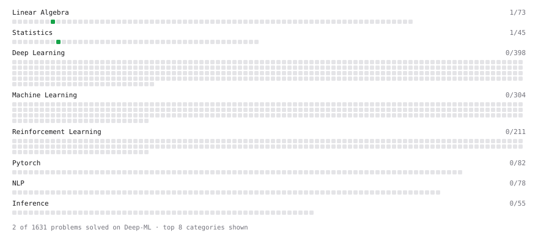

# Deep-ML

My machine learning practice from [Deep-ML](https://www.deep-ml.com). Every solution here was written by hand.

**6** solved · 4 problems · 0 labs · 2 math

[**Browse the interactive portfolio**](https://Chris-Mwiti.github.io/deep-ml/) to replay this filling in over time.

## Problems

| | Difficulty | Solved | |
| --- | --- | --- | --- |
| [Calculate 2x2 Matrix Inverse](https://www.deep-ml.com/problems/8) | easy | 2026-10-20 | [solution](problems/0008-calculate-2x2-matrix-inverse) |
| [Calculate Model Inference Statistics for Monitoring](https://www.deep-ml.com/problems/248) | easy | 2026-10-24 | [solution](problems/0248-calculate-model-inference-statistics-for-monitoring) |
| [Calculate P50/P95/P99 Latency Percentiles](https://www.deep-ml.com/problems/293) | easy | 2026-10-24 | [solution](problems/0293-calculate-p50-p95-p99-latency-percentiles) |
| [Feature Drift Detection using Population Stability Index](https://www.deep-ml.com/problems/253) | medium | 2026-10-25 | [solution](problems/0253-feature-drift-detection-using-population-stability-index) |

## Math

| | Difficulty | Solved | |
| --- | --- | --- | --- |
| [Descriptive Statistics](https://www.deep-ml.com/math-problems/18) | easy | 2026-10-24 | [solution](math/0018-descriptive-statistics) |
| [Orthogonality and Projections](https://www.deep-ml.com/math-problems/14) | medium | 2026-10-23 | [solution](math/0014-orthogonality-and-projections) |

---

_This file is regenerated by Deep-ML on every push._
